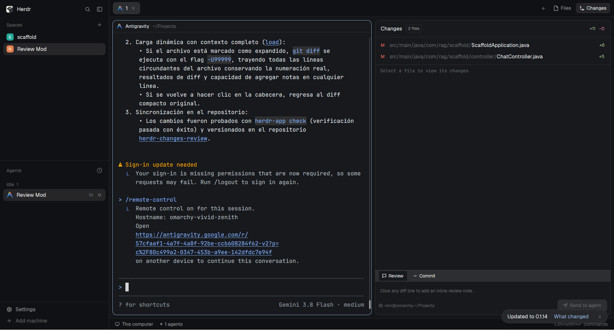

# changes-review

An enhanced diff viewer and line-by-line review mod for the Herdr desktop app. It extends Herdr's native Changes panel with inline review comments on changed diff lines, multi-line notes editing, a dedicated Review tab listing all notes with one-click navigation to file and line, expandable surrounding context on hunk headers, dynamic theme color inheritance, and one-click submission of formatted review feedback to the active agent.

## What you see

- **Header bar** (42px high, `border_b(1)` in `border`):
  - Left: "Changes" title in `font_semibold()`, file count badge in `muted` (`text_size(10)`, 4px rounded with 1px `border`).
  - Right: total additions in `text_color(add)` (`+N`) and deletions in `text_color(del)` (`−N`), using the theme's resolved diff colors (`ansi2` / `ansi1` by default).
- **Files list** (`changes-list`, scrollable, height 44px–160px based on file count, `border_b(1)`):
  - 28px rows with 7px rounded corners: status indicator (14px wide, `A` in addition color, `D`/`U` in deletion color, `M`/others in `blocked`), file directory path in `dim`, filename in `foreground`, and individual file additions (`+N`) and deletions (`−N`).
  - Active file is highlighted with `selected` background; hover uses `hover`.
- **Diff viewer** (`changes-diff-lines`, scrollable, fills remaining vertical space, JetBrains Mono font at 11px):
  - **Hunk header rows** (`kind === "@"`, 20px high): background in `raised`, bottom border in `border`, cursor pointer with `hover`. Left: diff hunk range (e.g. `@@ -1,12 +1,18 @@`) in `dim`. Right: compact badge pill in `background` showing `Expand context` (or `Collapse context` when expanded).
  - **Diff code rows** (20px high, cursor pointer):
    - Left gutter (30px wide, right-aligned): line number in `dim` (or semantically colored in `add`/`del` when modified).
    - Code text: truncated, colored with `add` for additions, `del` for deletions, and `foreground` for context lines.
    - Addition lines: background tinted with theme's `add` at 13% opacity (`#rrggbb22`), hover at 21% opacity (`#rrggbb35`).
    - Deletion lines: background tinted with theme's `del` at 13% opacity (`#rrggbb22`), hover at 21% opacity (`#rrggbb35`).
    - Unchanged context lines: transparent background, `hover` on mouse hover.
  - **Inline comment card** (docked directly underneath the commented line):
    - When active / editing: a card in `raised` with top and bottom borders in `border`. Contains a rounded, bordered textarea (`TextareaState`), a line indicator (`Line N`), a **Cancel** button, and a primary **Save** / **Update** button (`solid` / `solid_foreground` when valid).
    - When saved: a compact card in `raised` with comment icon in `muted`, multi-line comment text wrapped line-by-line in `foreground`, and a trash icon in `dim` (hover in `del`) to delete the note.
- **Bottom switcher bar** (28px high, `border_t(1)` in `border`, background `raised`):
  - Pill tabs for **Review** (with comment icon, label, and comment count badge) and **Commit** (with git-commit icon and label).
  - Selected tab has `background` and `foreground` text; unselected tab has `muted` text.
- **Review drawer** (visible when **Review** tab is selected, background `background`):
  - When empty: helper text in `dim` ("Click any diff line to add an inline review note.").
  - When notes exist: scrollable list of review cards (height up to 116px). Each card (26px high, `raised` background) shows comment icon, `file:line` badge in `muted`, truncated single-line preview of the note in `foreground`, and a trash icon to delete.
  - Footer bar: shows active agent target (`bot` icon and agent title) on the left. On the right: **Clear all** button (hover in `del`), and **Send to agent** button (`solid` / `solid_foreground` when notes exist) with send icon.
- **Commit drawer** (visible when **Commit** tab is selected):
  - Standard commit message input (32px high, rounded 8px, border `border` / focus `accent`) and **Commit** button.

## How it behaves

- **Opening diffs**: Clicking any file in the file list selects it (`this.open = path`) and loads its git diff asynchronously via `git diff HEAD -- <path>`.
- **Expanding context**: Clicking on any `@@ ... @@` hunk header row toggles `expandedFiles` for that file. When expanded, `git diff -U99999` is queried, displaying the complete file surrounding code without losing diff coloring, line numbers, or comments. Clicking again collapses back to the compact hunk view.
- **Adding inline review notes**: Clicking any diff line opens the inline textarea editor immediately below that line. Pressing **Save** or Enter saves the comment into `this.reviews` and renders the inline review note under the line. Pressing **Cancel** or Escape discards unsaved input.
- **Editing existing notes**: Clicking on an existing inline note or clicking its card in the Review list re-opens the editor with the cursor placed at the end of the text.
- **Review list navigation**: Clicking any review card in the bottom Review tab instantly jumps to that file, loads the diff (expanding context if the line is outside normal hunks), and focuses the comment editor on that line.
- **Deleting notes**: Clicking the trash icon on an inline note or in the Review list removes that note without triggering row click. **Clear all** empties the entire review list.
- **Send to agent**: Clicking **Send to agent** formats all accumulated review notes into a clear Markdown summary (`### Code Review Feedback for <branch>`, `- file:line: note` with original snippet) and transmits it to the currently focused agent via `hc terminal write` (or `hc send`). A transient notification confirms delivery.
- **Hot reload & Git watcher**: Watches the repository folder with `watchFolder`. Files and diffs automatically refresh when code changes on disk or git commits occur.

## Built from

- **Layout integration**: Replaces `{ "mod": "changes" }` in personal layouts (`main-copy.json` or custom layout) under `#panel-body` stack.
- **Mod files**:
  - `mods/changes-review/main.js`: Main GPUI View implementation.
  - `mods/changes-review/mod.json`: Manifest declaring `cloned_from: { name: "changes", version: "0.1.13" }` and `place: "none"`.
  - `mods/changes-review/changes.svg`: Panel icon for Herdr.
  - `mods/changes-review/icons/`: SVG assets (`comment.svg`, `send.svg`, `trash.svg`, `bot.svg`, `git-commit.svg`).
- **Herdr APIs used**:
  - `theme()`: Resolves active UI colors (`background`, `foreground`, `border`, `raised`, `hover`, `selected`, `dim`, `muted`, `accent`, `solid`, `solid_foreground`).
  - `settings()`: Reads user font family (`font_family`) and theme color overrides (`settings().colors`).
  - `layout()`: Reads active layout color overrides (`layout().colors`).
  - `spaces()`, `panes()`, `focused()`, `agents()`: Resolves working directory (`cwd`), SSH machine (`on`), and active coding agent.
  - `exec()`: Runs `git rev-parse`, `git status`, `git diff`, and `git commit`.
  - `readTextFile()`, `watchFolder()`: Reads untracked files and listens for workspace filesystem events.
  - `notify()`: Emits desktop toast notifications upon sending reviews.
  - `hc()`: Communicates with herdr-core to deliver review feedback.

## Watch out

- **No DOM or HTML**: Everything is native GPUI kit components (`div()`, `h_flex()`, `v_flex()`, `TextareaState`, `InputState`). Element methods like `.font_mono()` do not exist in GPUI; font family is set on the container using `.font_family(...)`.
- **Theme color inheritance**: Diff colors must not be hardcoded. `getDiffColors(t)` combines `theme()`, `settings().colors`, and `layout().colors`, falling back to `t.ansi2` and `t.ansi1`.
- **Opacity appending**: Color hex alpha appending (`#rrggbb22`) requires valid 6-digit hex format. `hexWithAlpha` safely normalizes 3, 6, and 8-digit hex colors before adding alpha.
- **Preserve git flags**: All `git` diff and status calls include `READ` flags (`--no-optional-locks -c core.fsmonitor=false -c diff.autoRefreshIndex=false`) to avoid touching `.git` index locks or triggering infinite folder watch cycles.

## Done when

1. `herdr-app check ~/.config/herdr-app/mods/changes-review` exits with code 0.
2. Opening a file with changes renders line numbers, addition lines in theme green (`ansi2`), and deletion lines in theme red (`ansi1`).
3. Clicking on a `@@ -... +... @@` hunk header toggles full surrounding file context with `-U99999` and updates the badge to `Collapse context`.
4. Clicking any diff line opens an inline comment editor; saving renders the note beneath the line and adds it to the **Review** list.
5. In the **Review** tab, clicking a review note navigates directly to that file and line.
6. Clicking **Send to agent** sends the structured Markdown review to the active agent terminal.
